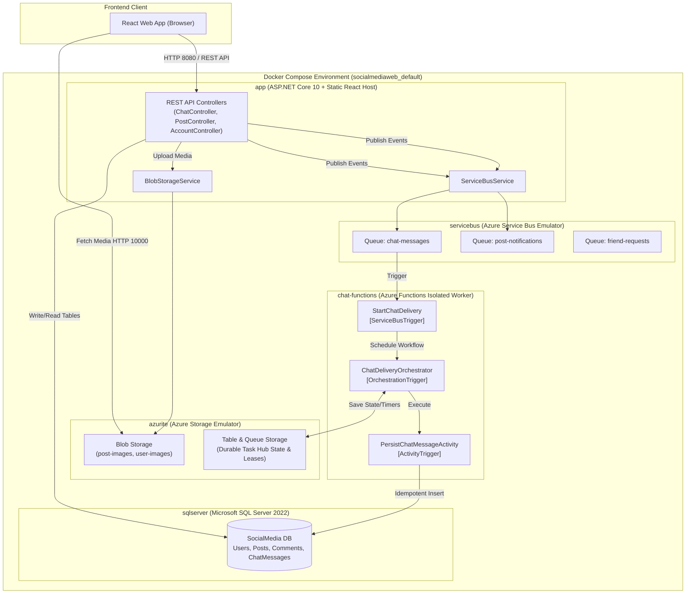
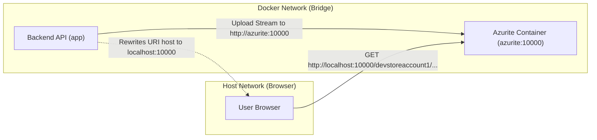
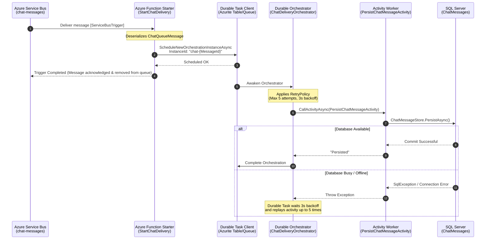
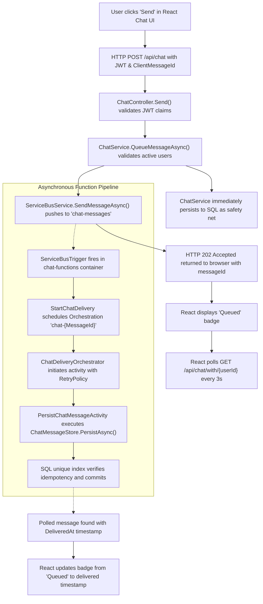
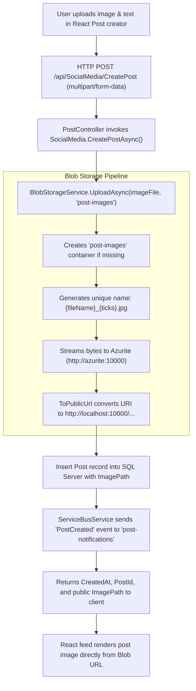

# Comprehensive Architecture Guide: Azure Service Bus, Azure Storage, Azure Functions, and Docker

This document provides a complete, top-to-bottom explanation of how **Azure Service Bus**, **Azure Data Storage (Blob, Table, Queue)**, and **Azure Functions (Durable Task)** are implemented and orchestrated with **Docker** in the **SocialButterfly (SocialMediaWeb)** platform.

---

## Table of Contents

1. [High-Level Architecture Overview](#1-high-level-architecture-overview)
2. [Azure Service Bus (Messaging Engine)](#2-azure-service-bus-messaging-engine)
   - [Core Concepts & Roles](#core-concepts--roles)
   - [Configured Queues](#configured-queues)
   - [Publisher Implementation](#publisher-implementation)
   - [Local Development with the Service Bus Emulator](#local-development-with-the-service-bus-emulator)
3. [Azure Data Storage (Media & Workflow State)](#3-azure-data-storage-media--workflow-state)
   - [Blob Storage for User Media](#blob-storage-for-user-media)
   - [Docker Network URL Transformation (Internal vs Public)](#docker-network-url-transformation-internal-vs-public)
   - [Storage for Azure Functions and Durable Tasks](#storage-for-azure-functions-and-durable-tasks)
   - [Local Emulation with Azurite](#local-emulation-with-azurite)
4. [Azure Functions (Serverless Durable Worker)](#4-azure-functions-serverless-durable-worker)
   - [Isolated Worker Model (.NET 10)](#isolated-worker-model-net-10)
   - [The Durable Chat Pipeline (Trigger -> Orchestrator -> Activity)](#the-durable-chat-pipeline-trigger---orchestrator---activity)
   - [Idempotency & Delivery Guarantees](#idempotency--delivery-guarantees)
5. [Docker and Docker Compose (System Orchestration)](#5-docker-and-docker-compose-system-orchestration)
   - [Container Topology & Service Roles](#container-topology--service-roles)
   - [Inter-Container Networking & DNS Resolution](#inter-container-networking--dns-resolution)
   - [Volume Persistence & Port Mapping](#volume-persistence--port-mapping)
   - [Build Strategy (Multi-Stage Dockerfiles)](#build-strategy-multi-stage-dockerfiles)
6. [End-to-End Execution Flows](#6-end-to-end-execution-flows)
   - [Flow 1: Sending and Processing a Durable Chat Message](#flow-1-sending-and-processing-a-durable-chat-message)
   - [Flow 2: Creating a Post with Media Upload](#flow-2-creating-a-post-with-media-upload)
   - [Flow 3: User Avatar Upload and Profile Rendering](#flow-3-user-avatar-upload-and-profile-rendering)
7. [Local Troubleshooting & Diagnostic Commands](#7-local-troubleshooting--diagnostic-commands)
8. [Transitioning from Local Emulators to Azure Cloud](#8-transitioning-from-local-emulators-to-azure-cloud)

---

## 1. High-Level Architecture Overview

The system is designed as a distributed, event-driven web application. A React single-page frontend communicates with an ASP.NET Core REST API, which delegates asynchronous background operations to Azure Service Bus and persists state across SQL Server and Azure Blob Storage. An independent Azure Functions worker listens to messaging queues to execute durable workflows.



---

## 2. Azure Service Bus (Messaging Engine)

### Core Concepts & Roles
Azure Service Bus is an enterprise-grade message broker using the AMQP 1.0 protocol. In this platform, it decouples user-facing synchronous HTTP operations from time-consuming or reliable background processing:
- **Asynchronous Decoupling**: When a user submits a chat message or creates a post, the HTTP API returns an immediate `202 Accepted` response rather than waiting for background tasks or cross-system transactions.
- **At-Least-Once Delivery**: The broker ensures messages are delivered to consumers even if the consumer temporarily crashes or restarts.
- **Duplicate Detection**: The broker tracks message uniqueness across a sliding time window based on the `MessageId`.

### Configured Queues
The queues are defined declaratively in [infra/servicebus/config.json](file:///D:/Dot%20Net/SocialMediaWeb/infra/servicebus/config.json):

| Queue Name | Purpose | Duplicate Detection Window | Max Delivery Count | Lock Duration |
| :--- | :--- | :--- | :--- | :--- |
| `chat-messages` | Carries direct messages to the Durable Function for database persistence and delivery orchestration. | `PT5M` (5 minutes) | 5 attempts | 1 minute |
| `post-notifications` | Dispatches post creation events for downstream notification or feed indexers. | None | 5 attempts | 1 minute |
| `friend-requests` | Reserved for friend request delivery and notification processing. | None | 5 attempts | 1 minute |

### Publisher Implementation
In the main backend API, publishers interact with Azure Service Bus via [`IServiceBusService`](file:///D:/Dot%20Net/SocialMediaWeb/Backend/Services/Interfaces/IServiceBusService.cs) implemented by [`ServiceBusService`](file:///D:/Dot%20Net/SocialMediaWeb/Backend/Services/Classes/ServiceBusService.cs):

```csharp
public async Task SendMessageAsync<T>(string queueName, T message, string? messageId = null)
{
    await using var sender = _client.CreateSender(queueName);
    var jsonBody = JsonSerializer.Serialize(message);
    var serviceBusMessage = new ServiceBusMessage(jsonBody)
    {
        ContentType = "application/json",
        Subject = typeof(T).Name,
        MessageId = messageId ?? Guid.NewGuid().ToString("N")
    };
    await sender.SendMessageAsync(serviceBusMessage);
}
```

Key aspects:
1. **`ServiceBusClient` Injection**: Injected via .NET Aspire / Azure SDK in [`Program.cs`](file:///D:/Dot%20Net/SocialMediaWeb/Backend/Program.cs#L43) using `builder.AddAzureServiceBusClient("servicebus")`.
2. **Stable `MessageId`**: In chat messaging, [`ChatService`](file:///D:/Dot%20Net/SocialMediaWeb/Backend/Services/Classes/ChatService.cs#L55-L68) derives the `MessageId` from a client-provided `ClientMessageId` or a new GUID. This ensures that if the browser sends a retry due to a network glitch, Service Bus automatically deduplicates it.

### Local Development with the Service Bus Emulator
Rather than requiring an active Azure subscription, the stack uses the official Microsoft Service Bus Emulator Docker image:
- **Image**: `mcr.microsoft.com/azure-messaging/servicebus-emulator:latest`
- **Dependency**: The emulator requires a SQL Server instance to store broker metadata and queue queues. In [docker-compose.yml](file:///D:/Dot%20Net/SocialMediaWeb/docker-compose.yml#L25-L40), it connects to `sqlserver` on port `1433`.
- **Config Mount**: `./infra/servicebus/config.json` is mounted to `/ServiceBus_Emulator/ConfigFiles/Config.json:ro`.
- **Ports**:
  - `5672`: AMQP messaging protocol port.
  - `5300`: HTTP administrative and health port.

> [!NOTE]
> The Service Bus Emulator supports a maximum `DuplicateDetectionHistoryTimeWindow` of 5 minutes (`PT5M`). Setting it higher causes the emulator to reject the configuration on startup.

---

## 3. Azure Data Storage (Media & Workflow State)

Azure Storage provides three core services used in this project:
1. **Blob Storage**: Used for unstructured image storage (user profile avatars and post photos).
2. **Table Storage**: Used by the Azure Durable Task extension for orchestration history, execution checkpoints, and instance tracking.
3. **Queue Storage**: Used internally by Durable Task for control queues and work-item scheduling.

### Blob Storage for User Media
[`BlobStorageService`](file:///D:/Dot%20Net/SocialMediaWeb/Backend/Services/Classes/BlobStorageService.cs) wraps the Azure SDK `BlobServiceClient`:
- **Containers**:
  - `user-images`: Stores user avatar profile pictures.
  - `post-images`: Stores images attached to user posts.
- **Automatic Container Creation**: When uploading, the service calls `CreateIfNotExistsAsync(PublicAccessType.Blob)` so containers are initialized on demand without manual provisioning.
- **Unique Blob Naming**: Blobs are formatted as `{originalFileName}_{timestampTicks}{extension}` to eliminate naming collisions.

### Docker Network URL Transformation (Internal vs Public)
A key architectural challenge in containerized environments is the difference between **internal container networking** and **external browser networking**:



1. **Inside Docker**: The `app` container communicates with the storage emulator using its Docker DNS name:
   `http://azurite:10000/devstoreaccount1/post-images/...`
2. **Outside Docker**: The browser cannot resolve the hostname `azurite`.
3. **The Solution**: [`BlobStorageService.ToPublicUrl`](file:///D:/Dot%20Net/SocialMediaWeb/Backend/Services/Classes/BlobStorageService.cs#L70-L107) inspects the generated URI. If `Blob:PublicBaseUrl` (or host `azurite`) is configured, it rewrites the URI host to `localhost` (or the configured public endpoint) before returning the URL to the client.

### Storage for Azure Functions and Durable Tasks
The Azure Functions host and Durable Task extension rely on `AzureWebJobsStorage`. This connection string points to Azurite in [docker-compose.yml](file:///D:/Dot%20Net/SocialMediaWeb/docker-compose.yml#L79):
- **Orchestration History (Table Storage)**: Durable Functions saves every completed step (`ExecutionStarted`, `TaskScheduled`, `TaskCompleted`) to table storage. If the worker container crashes, it replays the saved history upon restart to resume exactly where it stopped.
- **Control & Work Item Queues (Queue Storage)**: Manages internal execution queues (`chatdelivery-control-00`, `chatdelivery-workitems`) to schedule activity calls across function worker threads.
- **Blob Leases (Blob Storage)**: Used to coordinate worker instance leadership and partition management.

### Local Emulation with Azurite
- **Image**: `mcr.microsoft.com/azure-storage/azurite:3.35.0`
- **Command**: `azurite -L --loose --skipApiVersionCheck --blobHost 0.0.0.0 --queueHost 0.0.0.0 --tableHost 0.0.0.0 --location /data`
- **Mapped Ports**:
  - `10000`: Blob service.
  - `10001`: Queue service.
  - `10002`: Table service.
- **Persistent Storage**: Data is saved to Docker volume `azurite-data` mounted at `/data`.

---

## 4. Azure Functions (Serverless Durable Worker)

### Isolated Worker Model (.NET 10)
[`SocialMediaWeb.ChatFunctions`](file:///D:/Dot%20Net/SocialMediaWeb/Backend/SocialMediaWeb.ChatFunctions) runs as an out-of-process .NET 10 isolated worker. The isolated worker model separates the user function code from the Azure Functions host runtime process:
- Full dependency injection control via `HostBuilder` in [Program.cs](file:///D:/Dot%20Net/SocialMediaWeb/Backend/SocialMediaWeb.ChatFunctions/Program.cs).
- Independent package references without version conflicts with the Functions host.
- Native support for modern .NET 10 APIs and Entity Framework Core.

### The Durable Chat Pipeline (Trigger -> Orchestrator -> Activity)
Implemented in [ChatDeliveryFunctions.cs](file:///D:/Dot%20Net/SocialMediaWeb/Backend/SocialMediaWeb.ChatFunctions/ChatDeliveryFunctions.cs):



#### Step 1: Starter Trigger (`StartChatDelivery`)
- Triggered by `[ServiceBusTrigger("%ChatQueueName%", Connection = "ServiceBusConnection")]`.
- Injects `[DurableClient] DurableTaskClient`.
- Calls `client.ScheduleNewOrchestrationInstanceAsync` with an explicit, deterministic `InstanceId`: `$"chat-{message.MessageId:N}"`.
- **Check-point guarantee**: The Service Bus trigger only marks the message as completed after Durable Task acknowledges the orchestration scheduling. If the process terminates before this line, Service Bus redelivers the message.

#### Step 2: Orchestrator (`ChatDeliveryOrchestrator`)
- Marked with `[OrchestrationTrigger] TaskOrchestrationContext context`.
- Configures an automatic retry policy:
  ```csharp
  var retryOptions = new TaskOptions(
      new TaskRetryOptions(
          new RetryPolicy(maxNumberOfAttempts: 5, firstRetryInterval: TimeSpan.FromSeconds(3))));
  ```
- Calls `context.CallActivityAsync` with the defined retry policy.

#### Step 3: Activity Execution (`PersistChatMessageActivity`)
- Marked with `[ActivityTrigger] ChatQueueMessage message`.
- Executes actual database interaction via [`IChatMessageStore.PersistAsync`](file:///D:/Dot%20Net/SocialMediaWeb/Backend/Services/Classes/ChatMessageStore.cs).

### Idempotency & Delivery Guarantees
Because distributed systems (Service Bus redeliveries and Durable Task retries) operate under **at-least-once delivery**, operations can run more than once. The application handles idempotency at two levels:
1. **Durable Instance Deduplication**: Starting an orchestration with an existing `InstanceId` prevents creating a duplicate workflow for the same message.
2. **SQL Unique Index Boundary**: The `ChatMessages` table has a unique index on `MessageId`. In [`ChatMessageStore.PersistAsync`](file:///D:/Dot%20Net/SocialMediaWeb/Backend/Services/Classes/ChatMessageStore.cs#L30-L35):
   ```csharp
   if (await _context.ChatMessages.AnyAsync(chat => chat.MessageId == message.MessageId, cancellationToken))
   {
       return; // Already persisted, gracefully return success
   }
   ```
   If two concurrent workers attempt to insert the same `MessageId`, EF Core catches the unique constraint violation and treats it as idempotent success.

---

## 5. Docker and Docker Compose (System Orchestration)

### Container Topology & Service Roles
The stack defined in [docker-compose.yml](file:///D:/Dot%20Net/SocialMediaWeb/docker-compose.yml) consists of 5 core containers and 1 optional AI container:

| Service Name | Base Image | Internal Port | Host Port | Role |
| :--- | :--- | :--- | :--- | :--- |
| `sqlserver` | `mcr.microsoft.com/mssql/server:2022-latest` | 1433 | `1433` | Relational storage for users, posts, chats, and comments. |
| `azurite` | `mcr.microsoft.com/azure-storage/azurite:3.35.0` | 10000, 10001, 10002 | `10000-10002` | Emulates Azure Blob, Queue, and Table storage. |
| `servicebus` | `mcr.microsoft.com/azure-messaging/servicebus-emulator:latest` | 5672, 5300 | `5672, 5300` | Emulates Azure Service Bus AMQP queue broker. |
| `app` | Built from `./Dockerfile` (.NET 10 + React) | 8080 | `8080` | Combined web application hosting both frontend UI and backend API. |
| `chat-functions`| Built from `./Backend/SocialMediaWeb.ChatFunctions/Dockerfile` | - | - | Background Azure Functions worker processing chat queues. |
| `genai` *(optional)* | Built from `./Backend/GenAI/Dockerfile` (Python 3.12) | 50051 | `50051` | gRPC service providing AI-assisted caption and content generation. |

### Inter-Container Networking & DNS Resolution
When running `docker compose up`, Docker creates a custom bridge network named `socialmediaweb_default`. On this network:
- Every container can reach any other container using its **service name** as a DNS host name.
- Connection strings configured in `app` and `chat-functions` leverage this internal DNS:
  - **SQL Server**: `Server=sqlserver,1433;Database=SocialMedia;User Id=sa;...`
  - **Service Bus**: `Endpoint=sb://servicebus;SharedAccessKeyName=RootManageSharedAccessKey;SharedAccessKey=SAS_KEY_VALUE;UseDevelopmentEmulator=true;`
  - **Azurite**: `BlobEndpoint=http://azurite:10000/devstoreaccount1;QueueEndpoint=http://azurite:10001/devstoreaccount1;TableEndpoint=http://azurite:10002/devstoreaccount1;`

> [!WARNING]
> Running `docker run` directly on an individual container starts it on Docker's default bridge network, where **automatic container DNS is disabled**. Always run the complete multi-service stack using `docker compose up -d`.

### Volume Persistence & Port Mapping
The following named volumes ensure data persistence across container restarts and rebuilds:
- `sqlserver-data`: Preserves the SQL database files (`/var/opt/mssql`).
- `azurite-data`: Preserves blob contents, queue states, and table schemas (`/data`).
- `app-images` & `app-posts`: Fallback local disk mounts for static assets (`/app/wwwroot/Images`, `/app/wwwroot/posts`).

### Build Strategy (Multi-Stage Dockerfiles)
The project utilizes multi-stage builds to optimize image sizes and security:
1. **Main Web App (`Dockerfile`)**:
   - Stage 1 (`node:22-alpine`): Compiles React TypeScript/Vite frontend into `/src/Frontend/dist`.
   - Stage 2 (`dotnet/sdk:10.0`): Restores .NET projects, copies frontend dist into `Backend/wwwroot/`, and compiles ASP.NET Core in `Release` mode.
   - Stage 3 (`dotnet/aspnet:10.0`): Lightweight runtime image containing only the published binaries and static assets.
2. **Functions App (`Backend/SocialMediaWeb.ChatFunctions/Dockerfile`)**:
   - Stage 1 (`dotnet/sdk:10.0`): Compiles the Function project and dependencies.
   - Stage 2 (`azure-functions/dotnet-isolated:4-dotnet-isolated10.0`): Official Microsoft Azure Functions isolated runtime.

---

## 6. End-to-End Execution Flows

### Flow 1: Sending and Processing a Durable Chat Message



### Flow 2: Creating a Post with Media Upload



### Flow 3: User Avatar Upload and Profile Rendering
1. **Registration / Update**: User registers or updates their avatar at `POST /api/Account/register` or `POST /api/Account/updateprofile`.
2. **Blob Storage**: [`BlobStorageService`](file:///D:/Dot%20Net/SocialMediaWeb/Backend/Services/Classes/BlobStorageService.cs) places the image into the `user-images` container.
3. **Database URL**: The SQL `Users` table stores the generated URL.
4. **Read & Display**: When calling `GET /api/Account/users`, [`AccountController`](file:///D:/Dot%20Net/SocialMediaWeb/Backend/Controllers/AccountController.cs#L104) calls `_blobStorage.ToPublicUrl(u.ImagePath)` to ensure the browser receives a route reachable outside Docker (`http://localhost:10000/devstoreaccount1/user-images/...`).

---

## 7. Local Troubleshooting & Diagnostic Commands

### Managing the Docker Stack

```powershell
# Start the entire stack in background
docker compose up -d

# Start with real-time build of modified application containers
docker compose up -d --build app chat-functions

# Check status of all containers
docker compose ps

# View live consolidated logs
docker compose logs -f

# View specific service logs
docker compose logs app --tail 100 -f
docker compose logs chat-functions --tail 100 -f
docker compose logs servicebus --tail 100 -f

# Stop all containers
docker compose down

# Stop and wipe database/storage volumes (fresh clean state)
docker compose down -v
```

### Diagnostic Endpoints

- **Backend Swagger API**: [http://localhost:8080/swagger](http://localhost:8080/swagger)
- **Service Bus Emulator Health**: [http://localhost:5300](http://localhost:5300)
- **Azurite Blob Storage Endpoint**: [http://localhost:10000/devstoreaccount1](http://localhost:10000/devstoreaccount1)
- **SQL Server Direct Connection**:
  - Host: `localhost,1433`
  - User: `sa`
  - Password: `Change_this_password_123!` (or value defined in `.env`)

---

## 8. Transitioning from Local Emulators to Azure Cloud

When moving this project from local Docker Compose to Microsoft Azure cloud services:

| Component | Local Docker Environment | Production Azure Deployment | Code / Configuration Changes Required |
| :--- | :--- | :--- | :--- |
| **Service Bus** | `servicebus-emulator` container with `infra/servicebus/config.json` | Azure Service Bus Namespace (Standard or Premium tier) | Replace connection string with Azure Service Bus Endpoint or configure Managed Identity (`DefaultAzureCredential`). |
| **Blob Storage** | Azurite container (`devstoreaccount1`) | Azure Blob Storage Account | Set `ConnectionStrings:blobs` to `https://<account>.blob.core.windows.net/` and set `Blob:PublicBaseUrl` to Azure CDN or custom domain. |
| **Function Worker** | `chat-functions` container running in Docker | Azure Function App (Linux Container or App Service Plan) | Configure Application Settings: `AzureWebJobsStorage`, `ServiceBusConnection`, and `ConnectionStrings:Con`. |
| **Database** | `sqlserver` container | Azure SQL Database or SQL Managed Instance | Update `ConnectionStrings:Con` to Azure SQL Server connection string with encrypted connection. |
| **Authentication** | Shared secrets in `.env` | Azure Key Vault + Managed Identities (RBAC) | Grant `Azure Service Bus Data Receiver/Sender` and `Storage Blob Data Contributor` to the system-assigned managed identity. |

---
*Document maintained for SocialButterfly (SocialMediaWeb) engineering team.*
